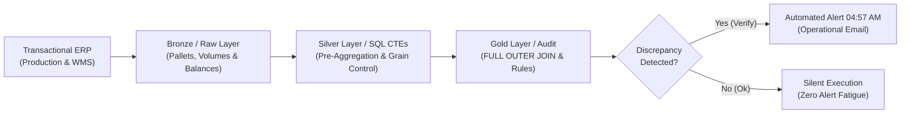

🌐 **Idioma / Language:** [🇧🇷 Português](README.md) | [🇺🇸 English](README.en.md)

# Automated Physical Reconciliation Audit: Palletized Inventory vs. Warehouse Balance

## 📌 Business Challenge

In high-throughput manufacturing environments, every production posting automatically updates inventory balances, whereas palletization relies on shop-floor operational workflows (opening pallets, scanning volumes, and closing unit loads).

When operational gaps occur—such as pallets left in **Open** status, production postings without corresponding pallet records, or inventory write-offs without closing the pallet—silent discrepancies emerge between system balances and physical palletized stock. Without proactive data quality checks, these mismatches were only uncovered during truck loading or cycle counts, causing shipping delays and operational rework.

## 🎯 Solution Objectives

* **Full Two-Way Reconciliation:** Simultaneously detect active pallets lacking inventory backing and warehouse balances in production storage locations without linked pallets.
* **Accelerated Root-Cause Diagnosis:** Isolate **Closed/Loaded** pallet quantities from **Open** pallets while listing exact pallet IDs and warehouse balances inline.
* **Exception-Driven Observability:** Automate daily pre-shift execution (04:57 AM), triggering email alerts **only** when actual discrepancies are detected (`status_auditoria = 'Verificar'`).

## 📐 Data Architecture & Lineage

The query architecture is structured around **multi-stage pre-aggregation CTEs** prior to the final join. Enforcing grain isolation prevents Cartesian products between multi-lot pallets and multi-bin warehouse balances, ensuring mathematical accuracy and deduplicated string aggregations.

## 🛠️ Engineering & Technical Solution

* **Two-Stage Pre-Aggregation (`cte_pallet_volumes` & `cte_saldos_deposito`):** Because pallet headers relate `1:N` to volume records (and balances relate `1:N` to lots/bins), metrics are first aggregated at the `id_pallet` and `codigo_deposito` grain before rolling up to `codigo_item` and `versao_item`.
* **Conditional Aggregation (`SUM(CASE WHEN ...)`):** Eliminates redundant table scans by computing both consolidated (`F`, `C`) and pending-closure (`A`) pallet volumes in a single index pass.
* **Bilateral Orphan Detection (`FULL OUTER JOIN` + `COALESCE`/`NVL`):** Unlike a standard `LEFT JOIN` that would drop orphan inventory balances with no pallets, a `FULL OUTER JOIN` captures 100% of anomalies across both sides of the operational workflow.
* **Inline Lineage Tracking (`LISTAGG`):** Formats pallet identifiers as `ID(Status)` (e.g., `10452(F), 10489(A)`) and warehouse balances as `Warehouse(Qty)` (e.g., `103(500), 106(200)`), enabling immediate troubleshooting without drill-down queries.

## 🚀 Business Impact

* **Pre-Shift Preventive Remediation:** Scheduled execution at **04:57 AM** equips Production Control and Shipping teams with an actionable exception list before daily operations begin.
* **Zero Alert Fatigue:** Suppressing email notifications whenever the inventory is 100% reconciled ensures every alert corresponds to an actionable discrepancy.
* **Faster Root-Cause Resolution:** Displaying warehouse balances alongside open and closed pallets on a single row allows operators to immediately distinguish between an unclosed pallet and a missing production posting.

---

📖 For execution details, business rules, and the output data dictionary, see the [Technical & Deployment Guide](docs/user_guide.en.md).
