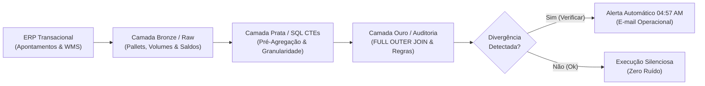

🌐 **Idioma / Language:** [🇧🇷 Português](README.md) | [🇺🇸 English](README.en.md)

# Auditoria Automatizada de Conciliação Física: Estoque Paletizado vs. Saldo por Depósito

## 📌 O Desafio de Negócio

Em ambientes industriais de alta movimentação, cada apontamento de produção gera automaticamente a entrada contábil/física no saldo de estoque, enquanto a unitização em pallets depende de etapas operacionais no chão de fábrica (abertura, conferência de volumes e fechamento).

Quando ocorrem falhas operacionais — como pallets esquecidos em status **Aberto**, apontamentos sem geração de pallet ou baixas de estoque sem encerramento do unitizador — surgem divergências silenciosas entre o saldo sistêmico e o estoque físico paletizado. Sem uma rotina proativa de auditoria, esses desvios só eram descobertos no momento do carregamento ou em inventários rotativos, causando atrasos na expedição e retrabalho operacional.

## 🎯 Objetivos da Solução

* **Auditoria Bilateral Completa:** Identificar simultaneamente pallets ativos sem lastro no saldo de estoque e saldos disponíveis nos depósitos produtivos sem nenhum pallet vinculado.
* **Diagnóstico Rápido de Causa Raiz:** Segregar volumes de pallets **Fechados/Carregados** de pallets **Abertos**, além de listar os identificadores exatos de pallets e depósitos na mesma linha de análise.
* **Observabilidade Orientada a Exceção:** Automatizar a execução diária antes do início do turno (04:57 AM), disparando alertas por e-mail **apenas** quando existem divergências reais (`status_auditoria = 'Verificar'`).

## 📐 Arquitetura e Linhagem de Dados

A arquitetura foi desenhada em **estágios de pré-agregação via CTEs** antes do cruzamento final. Esse isolamento de grão impede o produto cartesiano entre múltiplos lotes por pallet e múltiplos endereços por depósito, garantindo integridade matemática nas somas e evitando duplicidade nas listas textuais.

## 🛠️ Engenharia e Solução Técnica

* **Pré-Agregação em Dois Estágios (`cte_pallet_volumes` e `cte_saldos_deposito`):** Como a relação entre cabeçalho de pallet e volumes é `1:N` (assim como saldos por lote/endereço), os dados são primeiramente consolidados no nível de `id_pallet` e `codigo_deposito`. Somente no segundo estágio ocorre a agregação por `codigo_item` e `versao_item`.
* **Agregação Condicional (`SUM(CASE WHEN ...)`):** Evita múltiplas leituras nas tabelas transacionais ao calcular, em uma única passagem de índice, tanto o volume consolidado (`F`, `C`) quanto o volume pendente de fechamento (`A`).
* **Auditoria Bilateral (`FULL OUTER JOIN` + `COALESCE`/`NVL`):** Diferente de um `LEFT JOIN` tradicional que ocultaria saldos órfãos sem pallet, o `FULL OUTER JOIN` garante visibilidade de 100% das anomalias em ambas as extremidades do processo.
* **Rastreabilidade Inline (`LISTAGG`):** Consolida os identificadores no formato `ID(Status)` para pallets (ex.: `10452(F), 10489(A)`) e `Depósito(Saldo)` para estoque (ex.: `103(500), 106(200)`), permitindo atuação imediata sem necessidade de consultas secundárias.

## 🚀 Impacto no Negócio

* **Saneamento Preventivo Pré-Turno:** A execução agendada para as **04:57 AM** entrega à equipe de PCP e Expedição a lista exata de anomalias antes do início das operações diárias.
* **Zero Fadiga de Alertas:** A supressão automática de envio quando 100% da base está conciliada garante que cada e-mail recebido represente uma ação real necessária.
* **Redução Drástica no Tempo de Investigação:** Ao exibir na mesma linha o saldo por depósito, os pallets abertos e os pallets fechados, o operador identifica em segundos se a pendência exige apenas o fechamento de um pallet aberto ou o ajuste de um apontamento.

---

📖 Para detalhes de execução, regras de negócio e dicionário de dados, acesse o [Guia Técnico e de Implantação](docs/user_guide.md).
